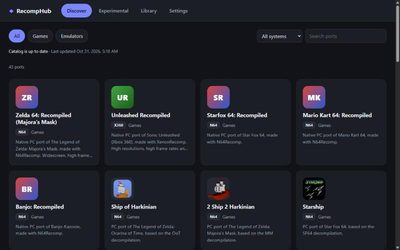

# RecompHub

**One place for native PC ports of N64, Xbox 360, PlayStation, GameCube and more,
made by the recompilation and decompilation community.**

Find a port, install it with one click, keep it updated without losing your saves,
and start it from the app, the start menu or Steam.

[**Download for Windows**](https://github.com/junkx420/ReCompX-Store/releases/latest) ·
[What's new](https://github.com/junkx420/ReCompX-Store/releases) ·
[Report a problem](https://github.com/junkx420/ReCompX-Store/issues)

## What you get

- **More than 80 ports** in one catalog, among them Zelda 64: Recompiled, Ship of
  Harkinian, Dusklight (Twilight Princess), Sonic Unleashed, Donkey Kong 64,
  Banjo-Kazooie, Perfect Dark, Castlevania: Symphony of the Night and many more.
  Ports that are still early have their own **Experimental** tab.
- **One-click install** straight from each project's official GitHub release. Every
  download is checked before anything is installed.
- **Updates that keep your saves.** Saves, settings and mods stay untouched; the
  previous version is kept, so you can go back with one click if an update has a
  problem.
- **Your own game files.** For ports that need a ROM in their folder, RecompHub checks
  your file and tells you if it is the wrong version.
- **Start menu, desktop and Steam.** Games get a start menu shortcut, and you can add
  them to your Steam library for the big-screen experience.
- **Controller friendly:** D-pad or stick to move, A to select, B to go back, LB/RB to
  switch tabs.
- **Updates itself** when a new RecompHub version is out.
- English and German.

## Install

1. Download `RecompHub_<version>_x64-setup.exe` from the
   [latest release](https://github.com/junkx420/ReCompX-Store/releases/latest).
2. Run it. It installs for your user only and needs no administrator rights.

Requires Windows 10 or 11, 64-bit.

## Questions

**Windows says "Windows protected your PC". Is that safe?**
The installer is not signed with a paid certificate yet, so SmartScreen does not know
it. Click **More info**, then **Run anyway**. The installer is built by this
repository's public GitHub workflow from the source you can read here.

**Do I need my own copy of the games?**
Yes. RecompHub never downloads, hosts or links ROMs, ISOs or other game data. Most
ports ask for a dump of a game you own on first start; the detail page of each port
says what it needs.

**What does "Experimental" mean?**
The port starts and can be played, but it is early: it may crash, miss content or
need workarounds. Check the project page before you dive in.

**Where are my games and saves?**
Games go to `%LOCALAPPDATA%\RecompHub\apps` unless you pick another library folder in
Settings. Saves stay where each port keeps them. When you uninstall a game, its saves
are kept by default and come back if you install it again.

**My virus scanner blocked a download.**
RecompHub does not install files a scanner flags. These are often false alarms for
recompiled games, but RecompHub leaves that decision to you and the port's authors;
check the project page.

**A port does not work.**
Problems with a game itself belong to that port's project (link on its detail page).
Problems with installing, updating or the app go
[here](https://github.com/junkx420/ReCompX-Store/issues).

## Thanks

RecompHub only installs the work of others. All credit goes to the people behind
[N64Recomp](https://github.com/N64Recomp/N64Recomp),
[XenonRecomp](https://github.com/hedge-dev/XenonRecomp),
[Harbour Masters](https://github.com/HarbourMasters) and every port in the catalog.
The catalog expansion uses the rated data of
[awesome-decomp-games](https://github.com/SubmitGame/awesome-decomp-games).

Want to add a port or help with the app? See [CONTRIBUTING.md](CONTRIBUTING.md).

## Legal

RecompHub is an unofficial fan project and is not affiliated with Nintendo, Microsoft,
Sony, Sega or any game publisher. All trademarks belong to their owners. RecompHub
itself is licensed under GPL-3.0-or-later; each port has its own license, shown on its
detail page.
